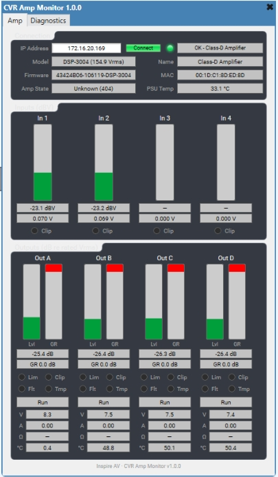

# CVR Amp Monitor

**An Atem Audio project** · [atem.audio](https://atem.audio)

A Q-SYS plugin for live, read-only monitoring of CVR Pro Audio DSP amplifiers over the network. It shows input and output meters, limiter gain reduction, per-channel state, temperatures, voltage, current and load impedance, all inside a Q-SYS design, without opening the vendor's amp controller software.

The plugin only listens. It sends status queries and the acknowledgements the amp's protocol requires, and never writes settings to the amp.

## Features

- **Input meters** (4 ch) in dBV, with input voltage readout and input clip LEDs
- **Output meters** (4 ch, A–D) in dB relative to the amp's rated RMS output voltage
- **Limiter gain reduction** meters per output, plus a Limit LED with an adjustable threshold
- **Per-channel status**: Normal, Standby, Fault, Open, Overload, Clip, DCP, Power Error, Over Temp, Limit, Sleep
- **Clip, Fault and Temp LEDs** per output, with a configurable hold so short events are visible
- **Output volts, amps, calculated load (Ω) and channel temperature**
- **Amp info**: model, device name, firmware, MAC, amp state, PSU temperature, fan voltage
- **Smooth metering**: a separate render timer applies attack/release ballistics so meters glide between heartbeat samples instead of stepping
- **Q-SYS Status** output that reports faults, offline amps and unknown models, ready to pin into a monitoring or alerting design
- **Diagnostics page** with packet counters, measured heartbeat rate, raw state bytes and a hex dump of the last heartbeat

## Compatibility

| | |
|---|---|
| Amplifiers | CVR Pro Audio DSP series, 4-channel "WHOLE118" heartbeat family |
| Firmware | 1.1.8 and 1.1.9 |
| Known models (rated Vrms) | DSP-654 (72.1), DSP-802 (80.0), DSP-1002 / 1004 (89.4), DSP-1502 / 1504 (109.5), DSP-2002 / 2004 (126.5), DSP-3002 / 3004 (154.9), DSP-3302 (162.5), DSP-4302 (185.5) |
| Dante variants | "D" models share the ratings of their analog counterparts |
| Q-SYS | Designer with Lua 5.3 plugin runtime (uses `string.pack`, `UdpSocket`, `Timer.Now`) |

Other models can still be monitored by choosing **Custom** and entering the rated output voltage.

## Installation

1. Download `src/CVR_Amp_Monitor.qplug` from this repo (or the latest release).
2. Copy it into your Q-SYS plugin folder:
   - Windows: `Documents\QSC\Q-Sys Designer\Plugins`
3. Restart Q-SYS Designer, or press **F5** in the Schematic Elements pane.
4. Find it under **Plugins → Atem Audio → CVR Amp Monitor** and drag it into your design.

> Upgrading from the earlier Inspire AV build: the plugin Id is unchanged, so existing designs pick up this version automatically. The plugin now sits under the **Atem Audio** folder in the Plugins list.

## Quick start

1. Give the amp a static IP on the same network as the Q-SYS Core.
2. Make sure UDP **45455** (to the amp) and **45454** (to the Core) aren't blocked between them.
3. Drop the plugin into the design and set **Amp Model** (leave on *Auto* to detect it from firmware).
4. Deploy, enter the amp's IP address, and press **Connect**.

The Online LED lights once the first heartbeat arrives, and the model, name and firmware fill in within a couple of seconds.

## Properties

| Property | Default | Description |
|---|---|---|
| Amp Model | Auto (from firmware) | Sets the 0 dB reference for output meters. *Auto* matches the model from the firmware string. *Custom* uses the value below. |
| Custom Rated Vrms | 100 | Rated RMS output voltage when Amp Model is *Custom* (10–400 V). |
| Poll Interval (ms) | 50 | How often a heartbeat is requested (20–1000 ms). |
| Meter Refresh (ms) | 30 | Render rate for smoothed meters (15–200 ms). Hidden when smoothing is off. |
| Meter Attack (ms) | 40 | Rise time constant. Set attack and release both to 0 to show raw values. |
| Meter Release (ms) | 250 | Fall time constant. |
| Indicator Hold (ms) | 750 | How long clip/limit/fault/temp LEDs stay lit after the event clears. |
| Limit LED Threshold (dB GR) | 1 | Gain reduction at which the Limit LED lights (also lit when the amp reports Limit state). |
| Offline Timeout (s) | 3 | Seconds without a reply before the amp is marked offline. |
| Listen Port | 45454 (CVR default) | Local UDP port. *Auto (ephemeral)* lets the Core pick one, useful if 45454 is taken. |
| Debug Print | Off | Prints protocol events to the Q-SYS debug output. |

## Controls and pins

Every front-panel control except the Diagnostics page is pinnable. See [docs/CONTROLS.md](docs/CONTROLS.md) for the full list with types, ranges and meanings.

## Status output

| Value | Q-SYS state | When |
|---|---|---|
| 0 | OK | Online, model known (shows the amp's name, or Standby / Sleep) |
| 1 | Compromised | Unknown model or unsupported heartbeat length |
| 2 | Fault | Any output in Fault, Open, Overload, DCP or Power Error, the amp itself in a fault state, or the UDP port can't be bound |
| 3 | Not Present | Disconnected, or no IP entered |
| 4 | Missing | Was online, now no reply within the timeout |
| 5 | Initializing | Connecting, or online but waiting for amp info |

## How it works

The plugin talks to the amp over UDP using CVR's native binary protocol: it requests a heartbeat (function code 6) every poll interval and basic device info (function code 0) until it has it, then every 30 seconds. Every data packet from the amp is acknowledged by echoing its header back, as the amp expects. See [docs/PROTOCOL.md](docs/PROTOCOL.md) for packet layouts.

## Troubleshooting

- **Stuck on "Connecting"**: check the IP, that the amp and Core can reach each other, and that UDP 45454/45455 aren't filtered. If the vendor software is open on another PC, it may be using the same ports; close it or switch Listen Port to *Auto*.
- **"Can't bind UDP 45454"**: something else on the Core already owns that port (often a second instance of this plugin). Set Listen Port to *Auto (ephemeral)*.
- **Output meters read "no model"**: Auto detection didn't recognise the firmware string. Pick the model manually or use Custom.
- **"unsupported body length"**: the firmware sends a heartbeat layout this plugin doesn't know yet. Send the hex dump from the Diagnostics page with an issue.
- **Meters feel sluggish or jumpy**: lower Meter Release for faster fall, raise Meter Attack to tame flicker, or check the measured heartbeat rate on the Diagnostics page.

## Credits

The protocol knowledge (packet framing, heartbeat layouts, state codes and the model voltage table) comes from the reverse-engineering work in [OpenAmpCore/ampcore](https://github.com/OpenAmpCore/ampcore) (`crates/ampcore-core/src/live/cvr`). This plugin is an independent Lua implementation written for Q-SYS; no ampcore source code is included. Thanks to the ampcore contributors.

CVR and CVR Pro Audio are trademarks of their respective owners. This project is not affiliated with or endorsed by CVR.

## License

[MIT](LICENSE) © 2026 Atem Audio. Use it, change it, ship it in your designs; just keep the copyright notice.

---

Atem Audio 
